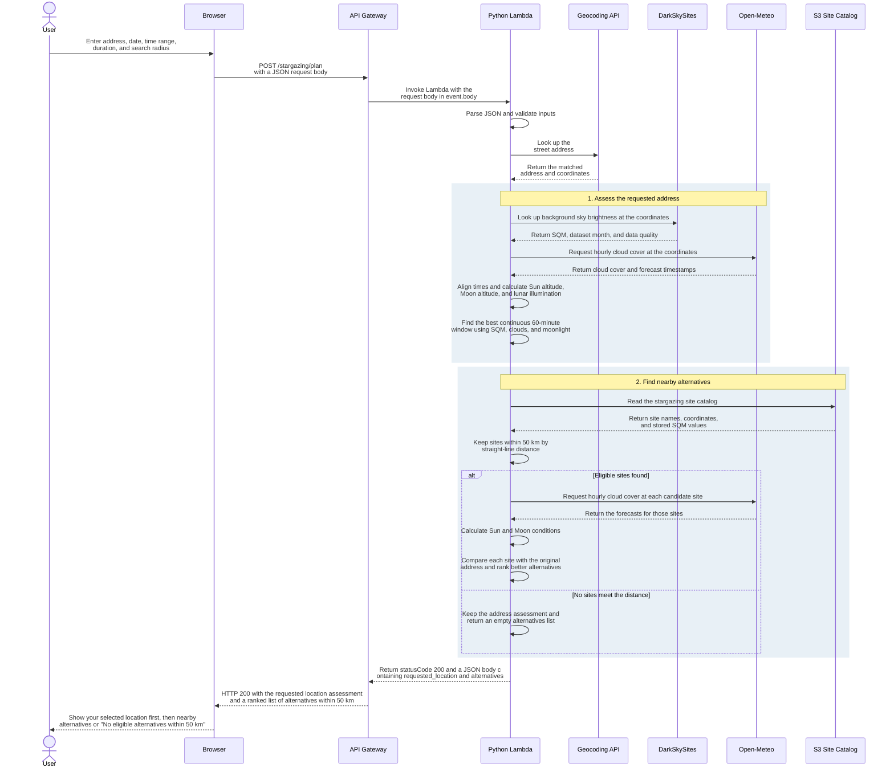

# Final Project Proposal
### Introduction

In this final project, we would like to build up a web application for helping people decide when and where to go stargazing. Users simply enter a street address or city name with the date and time range they would like to observe the universe. Our application would firstly assess user's selected location, then lists several official observatories within a 50km radius, sorted by priority. 

Our serverless web service will use Amazon API Gateway to receive requests, and use AWS Lambda to execute the planning logics. Amazon S3 will be used to store a verified directory of observation sites. The service will perform 3 distinct operations: 
1. geocode the requested location and evaluate observing conditions by taking the following data into account to explain the key influencing factors: a) Open-Meteo's cloud cover forecasts, b) background sky brightness simulated by DarkSkySites, and c) calculated positions of the sun and moon. 
2. search for the continuous time period within the user-specified timeframe that best matches the user's desired duration. Exclude windows with insufficient light, rate the remaining window based on cloud coverage, moonlight, and background sky brightness, and return the window with the highest rating. If no windows could be rated, return a message with explanation.
3. filter the observation sites in the directory based on distance, evaluating the forecast conditions at these sites during the qualifying time period, and rank those sites that offer better conditions than user's selected location.

#### Sequence Diagram
Here is a brief walkthrough of our project:

