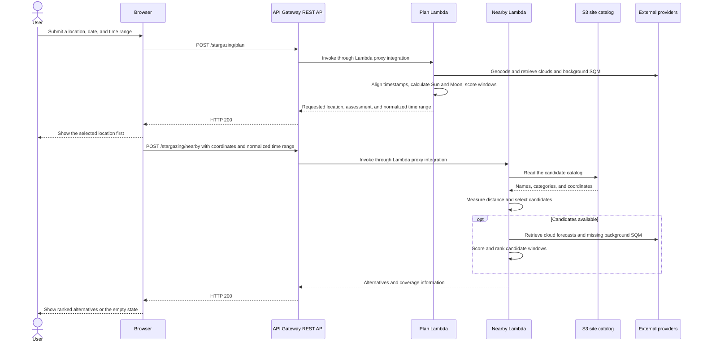

# Stargazing Planner

CS 310 Final Project · Fall 2026

This README is the team's implementation plan. Resource names, API fields, and limits below are proposed defaults. Replace them with the actual deployment details before submitting.

## 1. What the app does

A user enters a U.S. city and state or a U.S. street address, a date, and a local time range. The app evaluates that location, shows its best available 60-minute stargazing window, then shows ranked candidate sites within 50 km by straight-line distance. The selected location always occupies the first result area once geocoding succeeds, including when conditions are poor, data is incomplete, or the nearby search fails.

The first version uses hourly cloud forecasts from Open-Meteo, Sun and Moon calculations from Astronomy Engine, and modeled background sky brightness from DarkSkySites. At nearby sites, the catalog comes from Overture Places. This version leaves opening hours and public access checks for a future iteration. The UI labels alternatives as **candidate sites** and shows when the catalog has no entries in range. Coverage depends on the source data. The app makes no guarantee that stars will be visible.

**Demo input** · Evanston, Illinois, on a night within the provider's current forecast range, from 8 p.m. to midnight Chicago time. The page shows the assessment for Evanston first. Below it, the page displays candidate sites with their distance, best window, and the main factors in their score. Use an alternate saved demo case if the live forecast yields no viable windows.

## 2. Architecture and course requirements

**AWS components.** API Gateway hosts the REST web service. Two Python Lambda functions implement the routes. A private S3 bucket stores the candidate catalog. CloudWatch logs support deployment and debugging. A small static web page is the client and can run locally for the demo.

**Three distinct server-side operations to show in the video and description.**

1. **Model local viewing conditions.** Geocode the request, normalize its time range, align hourly forecasts to real instants, and calculate Sun altitude, Moon altitude, and lunar illumination for the location.
2. **Find the best continuous observing window.** Evaluate eligible 60-minute intervals using daylight, clouds, moonlight, and background SQM. Explain the selected interval or why no interval could be scored.
3. **Generate and rank nearby recommendations.** Filter a geospatial catalog by great-circle distance, evaluate each shortlisted site's own conditions over the same UTC interval, and rank returned sites with a deterministic tie-break.

The Final Project PDF requires an AWS web service, at least two additional server-side components, at least three distinct non-trivial server-side operations, and a client for the demo. Source references are listed in section 10.

## 3. Team ownership

Assign the two roles at kickoff. Each member owns a complete feature, from its inputs and data dependencies through its Lambda, tests, and results panel.

| Area | Member A · Assess a selected location | Member B · Find nearby candidates |
| --- | --- | --- |
| Endpoint | `POST /stargazing/plan` | `POST /stargazing/nearby` |
| Main work | Geocoding, location and time validation, hourly cloud and SQM adapters, astronomy and scoring module | Overture export, catalog checks and upload, S3 reads, distance, shortlist, and ranking |
| Cloud ownership | Plan Lambda, its role and logs, API Gateway stage and form integration | Nearby Lambda, its S3 read role and logs, catalog bucket and object |
| Frontend ownership | Page shell, search form, requested-location panel | Nearby results panel, distance and rank display, empty and partial-coverage states |
| Independent test | Input form and Plan Lambda run with geocoder, weather, and SQM fixtures. The nearby panel can use a fixture. | Nearby Lambda runs with fixture coordinates, UTC interval, catalog, and scoring results. The panel can run from a fixture response. |
| Handoff | Freeze the normalized location/time fields and scoring module interface at kickoff. Deliver the real scorer for final integration. | Freeze the catalog shape, ranking response, and panel interface at kickoff. Use a fake scorer with the same contract until the real module is ready. |

**Shared files and merging.** Member A owns the page shell and shared scoring implementation. Member B owns the nearby panel and test catalog. Keep work in separate branches and directories. Review shared field changes together. Each member can invoke their own Lambda from its Test tab before the shared API is deployed. Have Member A attach both route integrations and redeploy the shared stage after the function tests pass. Ship the same tagged revision of the scorer in both Lambda packages so scores remain comparable.

**Runtime handoff.** The browser calls Nearby after Plan returns usable coordinates and a normalized interval. Nearby receives those fields in its own request and can be tested or invoked independently. A provider failure that reduces the requested-location assessment can still allow nearby search if Plan has resolved the coordinates and interval.

## 4. Milestone 0 · Agree on the contract

- [ ] Assign Members A and B and choose the AWS account and Region. Use `us-east-2` if both teammates can access it. Record the account owner, Region, resource names, and stage in the team's notes.
- [ ] Pick the repository and create separate areas for the two Lambda handlers, shared scoring, the browser client, test fixtures, and catalog data. Share the repository and access needed for each person's resources.
- [ ] Freeze a successful and partial response example for each route, a small catalog fixture, and one error fixture. Use fictional addresses or public landmarks in saved examples.
- [ ] Choose one timezone convention and one scoring method before implementation. Record the defaults and any later changes.
- [ ] Test provider access with one public location. Confirm geocoder match quality, hourly cloud timestamps, the DarkSkySites key and data coverage, and catalog labels in the selected Overture release.

### API contract

Both routes accept JSON and return JSON. The deployed base URL includes the API Gateway stage, for example the `test` stage. Keep the resource paths below separate from the base URL.

| Route | Required request fields | Successful response fields |
| --- | --- | --- |
| `POST /stargazing/plan` | `location_type` of `city` or `address`, `location`, `state`, `date`, `start_time`, `end_time`. Use a two-letter U.S. state or DC code. Date is YYYY-MM-DD and local times are HH:MM. Include a ZIP code in a street address when available. | `requested_location` with display name, coordinates, and timezone. `interval` with `start_utc`, `end_utc`, and `duration_minutes`. `assessment` and `warnings`. |
| `POST /stargazing/nearby` | `latitude`, `longitude`, `timezone`, `start_utc`, and `end_utc`, copied from Plan. The service uses a fixed 50 km radius and 60-minute window. | `alternatives`, `candidate_count` within the radius before shortlisting, `shortlisted_count`, `evaluated_count`, and `warnings`. Each returned site includes ID, display name, coordinates, matched categories, distance in km, and an `assessment`. |

Each `assessment` includes a status of `scored`, `no_eligible_window`, or `insufficient_data`. A scored assessment contains the best window's start and end in UTC and its score, cloud summary, and moonlight summary. Return background SQM and source metadata when available. Return a null best window when a location cannot be scored. Label warnings with stable identifiers so the browser can display targeted messages.

| Status | Meaning and client handling |
| --- | --- |
| `200` | Render the result. A null best window, partial provider data, or zero nearby candidates can be a valid result. |
| `400` | Invalid input, unsupported date, or invalid/ambiguous local time. Show what needs correcting. An ambiguous city/address also uses this status and asks the user to refine the input. |
| `404` | A valid location search returned no match. Ask the user to check the city, state, or address. |
| `502` or `503` | A required dependency for that route is unavailable. For example, the geocoder is down or the catalog cannot be read. Keep the requested-location panel visible if only Nearby fails. |
| `500` | Unexpected application failure. Show a generic message and log the request ID for diagnosis. |

Use the requested location's timezone for both panels and label it on screen so side-by-side windows can be compared. Treat an end time earlier than the start as the next local day. Reject equal times and ambiguous or nonexistent times during daylight-saving transitions. Compare with UTC instants internally. Allow intervals from 1 to 12 elapsed hours in the initial version and enforce this on both routes. Use the provider's supported forecast horizon to validate the entire interval, including the following date for overnight queries. Missing forecast samples within that horizon follow the assessment's missing-data rules.

### Shared assessment rules

1. Accept coordinates, the UTC interval, and the 60-minute duration. The shared scorer consumes normalized cloud and SQM data and returns the assessment fields above. Adapters and fixed fixtures provide the same input shapes.
2. Align hourly cloud values and astronomy calculations in UTC. Use a 15-minute scoring grid beginning at the requested start. For each sample, use the hourly forecast from the UTC hour that contains it. Preserve missing data as missing.
3. For each 60-minute window that fits, inspect four 15-minute subintervals. Use their midpoints for cloud and Moon sampling. For darkness, check the Sun at the endpoints and midpoint of each subinterval. Use Sun altitude at or below −18° as the demo's astronomical-darkness rule on that sample grid. Treat the resulting times as estimates at the stated resolution.
4. Choose and record one scoring formula. A starting heuristic is 60% cloud clarity, 25% background darkness, and 15% moonlight. For cloud clarity, use one minus the mean cloud fraction. For background darkness, normalize SQM across a documented range such as 17–22 mag/arcsec² and clamp to 0–1. For moonlight, use one minus the mean of illumination fraction times positive sine of Moon altitude. The Moon at or below the horizon contributes zero penalty. Higher scores are better. SQM measures modeled background sky brightness, with higher values representing darker skies.
5. Score on a 0–100 scale, retain full precision for comparisons, and display rounded values. Break same-site window ties by earliest start. If no window meets the darkness rule, return `no_eligible_window`. If at least one window meets the darkness rule but none has the required data, return `insufficient_data`. When missing samples prevent checking darkness itself, use `insufficient_data` unless a complete eligible window can be scored. Label the score as a project heuristic.

## 5. Member A · Requested location

1. **Build the user form.** Let the user select city or street address. Provide a state field, a date, a start time, and an end time. Show the 60-minute duration and 50 km search radius as fixed values. Add a public example the user can load. Begin with fixture mode so the form and result panel can be tested immediately.
2. **Validate the request.** Parse the HTTP body, check the location fields and time formats, translate overnight ranges, and reject intervals shorter than 60 minutes after timezone conversion. Keep the maximum supported dates tied to the forecast coverage you actually request.
3. **Resolve coordinates.** Use the U.S. Census Geocoder for street addresses and Open-Meteo Geocoding for city search. Restrict city matches to the U.S. and the specified state. Handle no match and multiple plausible matches. Use the city result's timezone when provided and resolve the street address's timezone from coordinates, for example using Open-Meteo Forecast with `timezone=auto`. Never silently substitute the city center for an unmatched street address. [Census Geocoding API](https://geocoding.geo.census.gov/geocoder/Geocoding_Services_API.pdf) · [Open-Meteo geocoding](https://open-meteo.com/en/docs/geocoding-api)
4. **Fetch clouds.** Ask Open-Meteo Forecast for hourly `cloud_cover` for the resolved coordinates. Use UNIX timestamps and cover the entire requested interval. Test the mapping from timestamps to cloud percentages and make provider errors distinguishable from clear skies. [Open-Meteo forecast docs](https://open-meteo.com/en/docs)
5. **Fetch background SQM.** Call the DarkSkySites zenith SQM endpoint from the backend using the API key in the required header. Retain the actual dataset ID and quality metadata. Handle unknown SQM and provider rate limits with an explicit missing-data state. Keep the key in private deployment configuration. [DarkSkySites API docs](https://darkskysites.com/api-access)
6. **Implement the shared scorer.** Calculate Sun altitude, Moon altitude, and lunar illumination with Astronomy Engine for each relevant position and UTC instant. Apply the shared rules above and test with fixed timestamps and provider samples. Package this scorer and its dependencies as a shared local module both functions can build from. [Astronomy Engine for Python](https://github.com/cosinekitty/astronomy/tree/master/source/python)
7. **Build the Plan Lambda handler.** Keep request parsing, provider calls, and scoring easy to test separately. Use the Lambda proxy response format with `statusCode`, response headers, and a serialized JSON `body`. Include the normalized location and interval on a successful geocode even when the assessment is incomplete.
8. **Complete the requested-location panel.** Show the matched location, timezone, best window, score, clouds, Moon indicators, SQM with source label, and any warnings. Keep this panel visible when a later request for nearby sites fails.
9. **Verify Member A's slice.** Run fixed success, invalid input, after-midnight, no-dark-window, no-match, and missing-data cases locally. Deploy the Plan Lambda and pass a representative proxy-shaped event through the Lambda Test tab before attaching API Gateway.

## 6. Member B · Nearby candidate sites

1. **Start with a small fixture.** Use enough synthetic rows to test a site inside 50 km, one at the boundary, one outside, and two sites whose scores tie. Stub the scorer with known outputs until Member A's shared module is ready.
2. **Prepare the real catalog on a Mac.** Install DuckDB locally. If Homebrew is blocked by Command Line Tools, download and extract the official macOS CLI and run it directly from the extraction directory. Load its S3 extension and set the S3 Region to `us-west-2` for Overture's public dataset. The project catalog bucket uses your project's actual Region. [DuckDB download](https://github.com/duckdb/duckdb/releases) · [Overture DuckDB guide](https://docs.overturemaps.org/getting-data/duckdb/)
3. **Pin and check the Overture release.** Start with release `2026-10-21.0`. Confirm the canonical labels for `observatory` and `stargazing_area` using the version's taxonomy and legacy mapping before relying on exact matches. Scan the Places Parquet source for records with either target in the primary or alternate taxonomy. Filter to records with at least one U.S. address country code, a name, and valid point coordinates. This country filter can miss U.S. records without an address country. If a label is absent or there are few matches around the demo location, record what you find before changing categories. [Overture Places](https://docs.overturemaps.org/guides/places/) · [Versioned taxonomy downloads](https://docs.overturemaps.org/guides/places/taxonomy-explorer/)
4. **Validate and export.** Preview counts by matched category and sample names and coordinates in several regions. Keep one row per Overture ID, combining category matches when needed. Export the full filtered subset as a JSON array named `stargazing-sites.json`. Each record contains `id`, `name`, `latitude`, `longitude`, and `matched_categories`. Save the release, filters, counts, and attribution with the project data. Keep opening hours and access rules outside the schema for this version. [Overture attribution and licensing](https://docs.overturemaps.org/attribution/) · [DuckDB JSON export](https://duckdb.org/docs/current/sql/statements/copy)
5. **Create the private S3 catalog.** Create the project bucket and upload the file as `catalog/stargazing-sites.json`. Check object size and version or last-modified timestamp in S3. Configure the Nearby Lambda with the bucket name and object key. Give its execution role `s3:GetObject` for that object. On a catalog read error, return the dependency-error status. A successful read with no matching candidates should return an empty list. [AWS S3 upload guide](https://docs.aws.amazon.com/cli/latest/reference/s3/cp.html)
6. **Implement distance and shortlisting.** Validate coordinates and the supplied time interval, compute Haversine distance, and include sites at or below 50 km using unrounded distances. Exclude a catalog entry that matches the selected point within a small documented tolerance, such as 100 m, to avoid repeating it. Sort by distance and then by ID before taking a shortlist of five. Set the response's candidate count after filtering and before shortlisting.
7. **Evaluate and rank the shortlist.** Gather the shortlisted sites' hourly weather, batching coordinates where supported and verifying the response-to-site mapping. Look up their background SQM with a cap on calls and reuse an exact match when data for that coordinate is already available. Score each site over the original UTC interval with the same scorer and config as Plan. Rank scored sites by score descending, then distance ascending, then ID. Return up to three scored sites. Count how many candidates were in range, how many were shortlisted and evaluated, and report missing assessments as warnings. Describe results as ranked within the shortlist.
8. **Complete the nearby panel.** Show each candidate's name, distance, best window, and score. Show separate messages for no catalog entries in range, entries found but no scorable windows, partial coverage, and a request failure. Allow the browser to display the requested location while nearby results are still loading.
9. **Verify Member B's slice.** Run fixture tests with no AWS dependency. Deploy the Nearby Lambda and test it using supplied coordinates and the UTC interval from a fixture. Confirm that it can read the actual S3 object with only its own execution role, then test a real location that yields a nonempty shortlist.

## 7. AWS deployment and browser integration

Follow the Lab 05 order, **Lambda Test tab → API Gateway → deployed stage → real client**. Apply Lab 03's habit of testing each dependency separately and Lab 04's habit of retesting the deployed service after changes.

1. **Prepare the Lambda packages.** Select the same supported Python runtime and architecture for both functions, and pin the dependencies. Put handler modules where the configured handler can import them. Package libraries alongside the handlers in ZIPs, or use a Lambda Layer following Lab 05. For a layer, put dependencies under the top-level `python/` directory. Build any native dependencies for the matching Lambda Linux environment and architecture. [AWS ZIP packaging](https://docs.aws.amazon.com/lambda/latest/dg/python-package.html) · [AWS Python layers](https://docs.aws.amazon.com/lambda/latest/dg/python-layers.html)
2. **Create and test the functions in Lambda.** Create one function per feature in the same Region as the REST API, deploy each package, and set runtime configuration and execution permissions. Give both functions CloudWatch logging access. Check imports and the proxy response structure in the Test tab. Set per-provider timeouts and an overall time budget below API Gateway's configured integration timeout. Start with bounded parallel requests for independent providers or sites. Record the working Lambda configuration.
3. **Create the REST API.** In API Gateway, create a REST API named `StargazingPlanner` and a `/stargazing` parent resource with `/plan` and `/nearby` children. Add POST to both children, select the corresponding Lambda, and enable Lambda proxy integration. Check that API Gateway is permitted to invoke each Lambda. Deploy the API to a `test` stage and copy the stage Invoke URL. Redeploy that stage after changing resource, method, or Gateway CORS settings. [AWS REST API Lambda proxy integration](https://docs.aws.amazon.com/apigateway/latest/developerguide/set-up-lambda-proxy-integrations.html)
4. **Test each deployed route by itself.** Use an HTTP client to send the saved JSON examples to both stage URLs. Confirm HTTP status and JSON body together. The client should receive the application JSON. Inside Lambda, the logged proxy result contains the outer response fields and serialized body.
5. **Enable browser access.** Serve the static HTML, CSS, and JavaScript from a local HTTP server for the demo. Set the API base URL in a single client configuration value. If client and API are on different origins, configure OPTIONS preflight for both POST routes to allow the actual client origin, POST and OPTIONS, and the Content-Type header. Add the allowed-origin header to Lambda responses, including errors, and configure equivalent headers for Gateway-generated error responses where needed. Validate with the browser's Network panel. If the team wants a hosted page, use a separate private S3 frontend bucket served by CloudFront and configure that deployed origin in CORS. [API Gateway REST CORS](https://docs.aws.amazon.com/apigateway/latest/developerguide/how-to-cors.html) · [CloudFront access to private S3](https://docs.aws.amazon.com/AmazonCloudFront/latest/DeveloperGuide/private-content-restricting-access-to-s3.html)
6. **Wire the browser flow.** On submit, clear stale results, disable the button during initial loading, and post the form to Plan. Render the selected-location panel immediately on success. Request Nearby using Plan's normalized fields. Render alternatives in a separate panel and prevent a late response from an older search from replacing a newer one. Keep provider keys and S3 credentials out of the client.
7. **Finish the demo UI.** Use one page with a form, a prominent **Your location** card, and a **Nearby alternatives** list. Each candidate card has its distance, window, score, and a short explanation of its conditions. Make loading and error states readable, label all times and units, and check the layout at mobile width. A map is optional.
8. **Check logs and the deployed configuration together.** Confirm each invocation can be traced in CloudWatch by route and request ID. Log timings and provider statuses without logging credentials, the complete request, or the user's full address. A 502 merits checking Lambda output format, function logs, and invoke permissions. If an HTTP client works but the page fails, inspect OPTIONS and the response headers. If only Nearby fails, check the catalog key and role. Record the stage URL, allowed frontend origin, catalog release, and deployment revision in the handoff.

## 8. Acceptance and demo checklist

- [ ] **Selected location first.** The initial response shows the chosen address or city first. Nearby results never move it out of that position.
- [ ] **City and street address.** At least one of each resolves to the expected location. Unmatched or ambiguous input shows a useful message.
- [ ] **Overnight and timezones.** An 8 p.m.–midnight search ends on the next calendar day. Confirm timestamps against the displayed timezone, test a DST edge case, and verify candidates use the same UTC interval.
- [ ] **Window score.** With known fixture clouds, Sun, Moon, and SQM, the scorer picks the expected window. Include an all-daylight case, a missing cloud sample, and a Moon-below-horizon case.
- [ ] **Candidate boundary and order.** Check 49.9 km, 50.0 km, and 50.1 km with a small tolerance in the test data. Confirm ties resolve consistently and the shortlist and response caps are enforced.
- [ ] **Empty and degraded states.** Test a region with no sites, a candidate with missing weather, missing SQM, and an unavailable catalog. Confirm the first panel survives a Nearby error. Confirm the UI distinguishes missing data from an unfavorable forecast.
- [ ] **End-to-end.** From a fresh browser window, submit against the deployed AWS stage. Verify the two requests, both result states, and the final ordering. Test from the exact device and origin used for the recording.
- [ ] **Reproducibility.** Have the teammate who did not deploy follow the setup steps from a clean checkout, using the committed fixture and a fresh client config. Verify key setup, function packages, S3 object location, API stage, and starting the browser client. Record the exact commands in the final submission's installation instructions once they're known.
- [ ] **Demo recording.** Show the architecture, then a successful search with the selected location and ranked alternatives. Explain the three server-side operations with the result on screen. Prepare a second case for an empty or partial result and label any fixture-based demonstration clearly. Both teammates speak and show their feature.

## 9. Canvas submission

| Milestone | Deadline (CST) | Deliverable |
| --- | --- | --- |
| Proposal | Friday, November 20, 2026, 11:59 p.m. | One or two paragraphs covering the user problem, AWS server components, and the three distinct operations. |
| Final | Wednesday, December 2, 2026, 11:59 p.m. | Submit the video, description PDF, and artifacts ZIP to their separate Canvas assignments. The PDF specifies no late submissions. |

- [ ] **Final Project: Video.** A 5–10 minute overview and demo. Both members participate. Submit the video or a link.
- [ ] **Final Project: Description.** A PDF, typically 2–3 pages, showing the components and data flow and documenting endpoints, HTTP methods, parameters, response bodies, status codes, and the S3 catalog schema.
- [ ] **Final Project: Artifacts.** ZIP the project folder with the Lambda and client source, dependency manifests, catalog data or a redistributable sample with reproducible export instructions, relevant deployment files, and the installation instructions. The course specifically asks for **`readme.txt`**. Create it for this ZIP with the commands and deployment settings that you actually tested. Use dummy configuration values and list how graders can supply any required provider key. Include a Dockerfile if you use one.
- [ ] The same teammate who submitted the proposal submits the final deliverables for the group. Click **Submit** for each assignment and check the Canvas confirmation.

## 10. Course references

- **CS 310 Final Project v1.0**, pp. 1–3. Scope, proposal, Canvas assignments, and final deliverables.
- **Lab 05 · Programming Serverless with Lambda.** Implementation and Test-tab invocation before defining REST resources and methods, Lambda proxy integration, stage deployment, client testing, CloudWatch logs, and the Python requests layer.
- **Lab 03 · Web Service Using JS.** Test individual service dependencies and client responses before moving on to deployment.
- **Lab 04 · Elastic Beanstalk deployment lab.** Reproducible configuration and validation after deploy.
